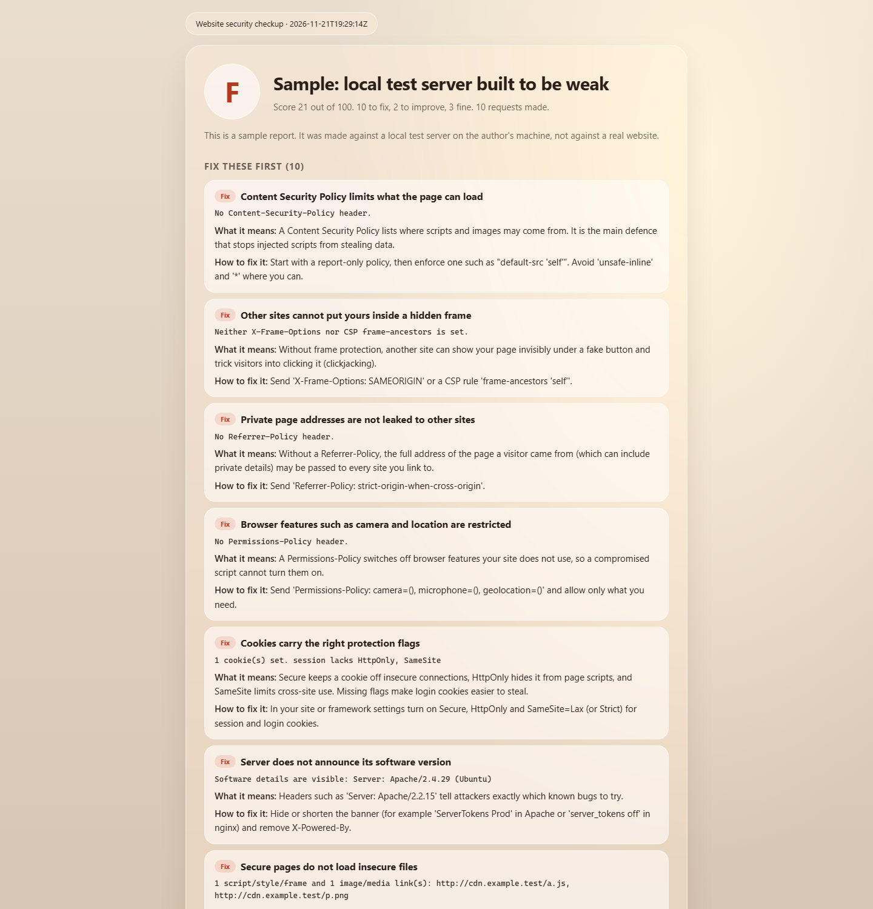

# site-security-check

[](https://github.com/chasebuilds/site-security-check/actions/workflows/ci.yml)

A passive security checkup for a small-business website. It makes a handful of ordinary requests, then writes a plain-English report a business owner can read: a grade, what each problem means, and how to fix it. It also writes JSON for anyone who wants the raw results.

**Live sample report:** https://chasebuilds.github.io/site-security-check/ (made against a local test server, not a real site)



## Authorized use only

Run this **only on sites you own, or have written permission to check.** It sends real requests to whatever address you give it. Checking someone else's site without permission can be illegal where you live, and it is not what this tool is for.

The command line enforces the rule: it refuses to run unless you pass `--i-have-permission`. That flag is a statement from you, not a technical lock.

What it will not do, by design: fuzzing, brute force, port scans, login attempts, exploit attempts, or crawling beyond a few pages. It does not send payloads. It stays passive.

## Install and run

```powershell
pip install git+https://github.com/chasebuilds/site-security-check
sitecheck https://example.com --i-have-permission
```

That writes `report.html` and `report.json` in the current folder. Open the HTML file in a browser.

Options:

| Option | Default | Meaning |
|---|---|---|
| `--i-have-permission` | required | Confirms you own the site or have written permission |
| `--html FILE` / `--json FILE` | `report.html` / `report.json` | Where to write results |
| `--max-pages N` | 3 | Pages to read, homepage included |
| `--delay SECONDS` | 0.5 | Pause between requests |
| `--timeout SECONDS` | 10 | Per-request timeout |
| `--email-domain D` | site host | Domain to check for SPF and DMARC |

Exit codes: 0 done, 2 permission flag missing, 3 scan could not run (unreachable, bad URL, or robots.txt asks tools to stay out).

## What it checks

| Check | How |
|---|---|
| HTTPS redirect | One `HEAD` to the `http://` address; expects a redirect to `https://` |
| Certificate expiry and issuer | One TLS handshake, no request |
| HSTS | Header on the homepage; `max-age` of at least 180 days |
| Content-Security-Policy | Header present; flags `unsafe-inline`, `unsafe-eval`, `*` |
| Clickjacking protection | `X-Frame-Options` or CSP `frame-ancestors` |
| X-Content-Type-Options | Header is `nosniff` |
| Referrer-Policy | Present and not `unsafe-url` |
| Permissions-Policy | Header present |
| Cookie flags | `Secure`, `HttpOnly`, `SameSite` on every `Set-Cookie` seen. Names only, never values |
| Server and version banners | `Server`, `X-Powered-By`, `X-AspNet-Version` showing a version |
| Mixed content | `http://` scripts, styles, frames and images on the pages read |
| Exposed files | One `HEAD` each for `/.git/HEAD`, `/.env`, `/wp-config.php.bak`, `/server-status`. Reported only as reachable or not; contents are never read |
| Old CMS version | The `generator` meta tag against a small minimum-version table |
| security.txt | One `GET` of `/.well-known/security.txt` |
| SPF and DMARC | Two DNS TXT lookups |

Scoring starts at 100 and subtracts each check's weight (half the weight for a warning). A reachable secret file caps the grade at D whatever else is fine. Weights are in `src/sitecheck/advice.py`.

## How polite it is

A default run reads the homepage and up to two more same-site pages. In local runs it made 10 to 12 HTTP requests; the hard limit is under 20. It waits 0.5 seconds between requests and identifies itself with a `sitecheck` User-Agent that links to this repo.

It reads `robots.txt` first. If the homepage is disallowed it stops. Extra pages that `robots.txt` disallows are skipped. The four fixed exposed-file requests and the security.txt request are a short, named list and do not consult `robots.txt`.

The exposed-files check first requests one made-up path. If the site answers 200 for a page that cannot exist, the check reports "inconclusive" instead of a false alarm.

## Tests

```powershell
python -m venv .venv
.venv\Scripts\python -m pip install -e ".[dev]"
.venv\Scripts\python -m pytest
```

38 tests. Scans run only against local servers on `127.0.0.1` that the tests start themselves: a deliberately weak site (no headers, version banners, a `.env` file, weak cookies, old WordPress tag), a strong HTTPS site with a throwaway self-signed certificate, and variants for mixed content, near-expiry certificates, `robots.txt` rules and soft-404 behaviour. The tests also check that the weak site only ever receives the expected requests and that the permission flag blocks everything when missing. CI never contacts a third-party site. DNS is faked in tests.

CI runs ruff, mypy in strict mode and pytest on Python 3.11 and 3.13.

`python examples/make_sample.py` rebuilds the sample report from a local server.

## Limitations

See [LIMITATIONS.md](LIMITATIONS.md). Short version: it reads one homepage and a few pages, it cannot see anything behind a login, and a good grade is not proof of security.

## License

MIT, Chase Builds.

## More from Chase Builds

- **[pdf-qa-local](https://github.com/chasebuilds/pdf-qa-local)**: Ask questions about your PDFs with AI that runs on your own computer, so documents never leave the office.
- **[table-export-extension](https://github.com/chasebuilds/table-export-extension)**: Export any web table to Excel. No data leaves the browser. ([live demo](https://chasebuilds.github.io/table-export-extension/))
- **[pc-build-planner](https://github.com/chasebuilds/pc-build-planner)**: A parts list for an office or CAD workstation where every part fits. ([live demo](https://chasebuilds.github.io/pc-build-planner/))

[All projects, sorted by industry](https://github.com/chasebuilds) · [chasebuilds.github.io](https://chasebuilds.github.io)
